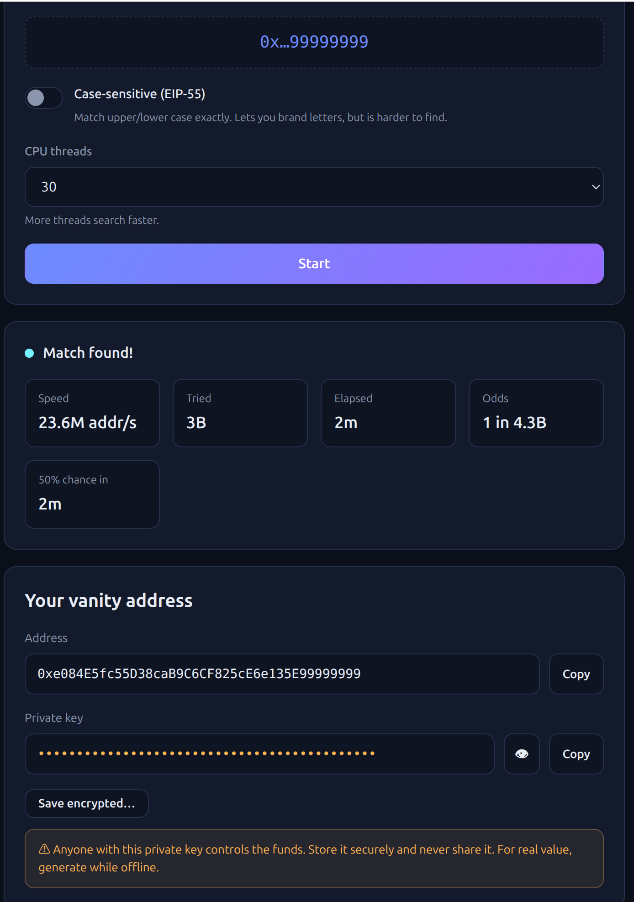

# vanity — crypto vanity address generator core

[](https://x.com/mollycoddle330)

The Rust cryptographic core of an offline vanity address generator: given a
desired prefix and/or suffix, it searches for a private key whose derived
address matches. Everything is local and deterministic — no network, no
server, no global state.

**Live tool:** https://yulaika.com/tools/vanity-address/ — the full
browser-based generator (all chains, 8 languages, WebGPU acceleration) built on
this core. Follow us on X: [@mollycoddle330](https://x.com/mollycoddle330)

This repository contains **only the core crate** (`src/`). It is meant to be
read, audited, and built on — not a turnkey product. There is no UI, no build
of a website, and no precompiled binary; you wire it into your own front end
(it compiles cleanly to WebAssembly or runs natively).

## Supported chains

| Chain | Curve / hash | Address |
|-------|--------------|---------|
| EVM (Ethereum / Base / BNB / any EVM) | secp256k1 + keccak256 | `0x…` (optional EIP-55 case match) |
| Tron | secp256k1 + keccak256 | base58check `T…` |
| Bitcoin (legacy P2PKH) | secp256k1 + SHA256/RIPEMD160 | base58check `1…` |
| Bitcoin (SegWit v0) | secp256k1 + SHA256/RIPEMD160 | bech32 `bc1q…` |
| XRP | secp256k1 + SHA256/RIPEMD160 | base58check `r…` (XRPL alphabet) |
| Solana | ed25519 | base58 public key |
| Sui | ed25519 + BLAKE2b-256 | `0x…` (64 hex) |

secp256k1 chains use a full-affine incremental search (a fixed base point plus
a precomputed `1G…NG` table sharing one batched field inversion per window), so
each candidate costs roughly one field inversion's share instead of a full
scalar multiplication. ed25519 chains (Solana/Sui) derive a fresh keypair per
candidate and so are inherently slower.

A separate mnemonic searcher goes the other way for HD wallets: it draws a
random BIP-39 phrase, derives at the chain's standard account (BIP-44/BIP-84
for secp256k1, SLIP-0010 for ed25519) and matches — so the phrase truly
restores to that address in a standard wallet.

## Performance

Real measured throughput — **23.6M EVM addresses/sec** across 30 CPU threads
(WebAssembly, in-browser), finding an 8-character `…99999999` suffix in ~2
minutes (~3B attempts):



Single-thread is roughly **0.7M EVM addr/s per core**; throughput scales about
linearly with threads. base58 chains (Tron/Bitcoin/XRP) are somewhat slower per
attempt because of the address encoding in the hot loop.

## Layout

```
src/
  lib.rs        crate root: module tree + public re-exports
  chain.rs      the Chain enum (parse / lead char)
  hashes.rs     keccak/sha/ripemd/hmac, hex, EIP-55, matching, RNG
  secp.rs       secp256k1 field/point + EVM/Tron/BTC/XRP encoders, base58check
  ed25519.rs    Sui address + suiprivkey encoding
  hd.rs         BIP-39 / BIP-32 / SLIP-0010 derivation
  searcher.rs   raw-key Searcher (the incremental hot loop) + Found
  mnemonic.rs   MnemonicSearcher + MnemonicFound
  api.rs        standalone exported functions
  tests.rs      correctness vectors + fuzz tests
```

Public API (re-exported from `lib.rs`): `Searcher`, `Found`,
`MnemonicSearcher`, `MnemonicFound`, and the free functions `address_of`,
`eth_address`, `privkey_display`, `estimate`.

## Build & test

```bash
# native build / test (k256, ed25519, etc. all work on the host):
cargo build --release
cargo test --release

# WebAssembly:
rustup target add wasm32-unknown-unknown
cargo build --release --target wasm32-unknown-unknown
# (then run wasm-bindgen over the .wasm to get JS bindings)
```

Correctness is anchored on published vectors (e.g. ETH priv=1 →
`0x7E5F…Bdf`, BTC priv=1 → `1BgGZ9…`, SegWit priv=1 → `bc1qw508d6…`, BIP-44
`abandon…about` → `0x9858EfFD…`) — see `src/tests.rs`.

## Security notes

- Anyone holding a private key controls the funds at that address. Store keys
  securely and never share them.
- For addresses that will hold real value, generate on an offline machine.
- `mnemonic → key` is one-way: you cannot produce a seed phrase for a chosen
  private key. The mnemonic searcher only ever goes forward (random phrase →
  derive → match).

## License

MIT
